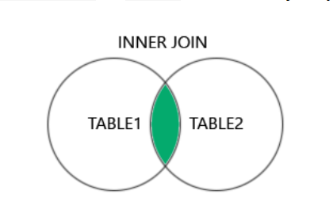
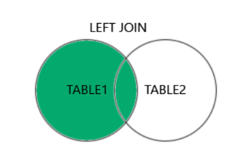
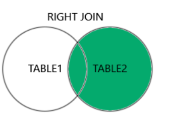
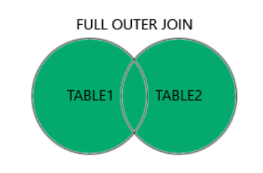
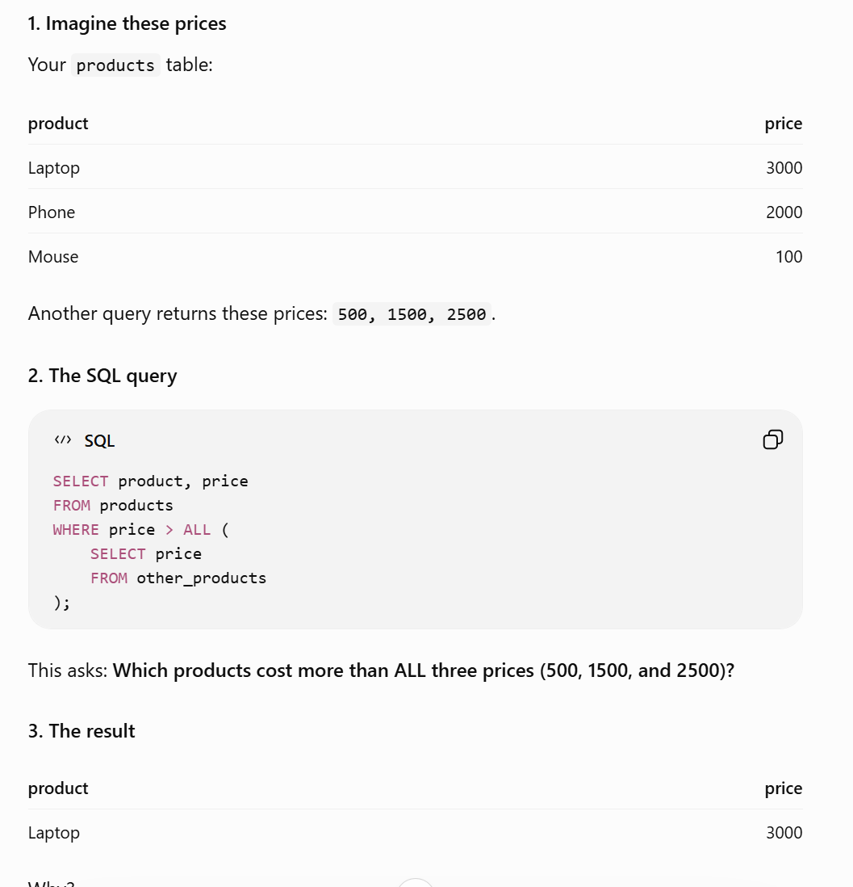
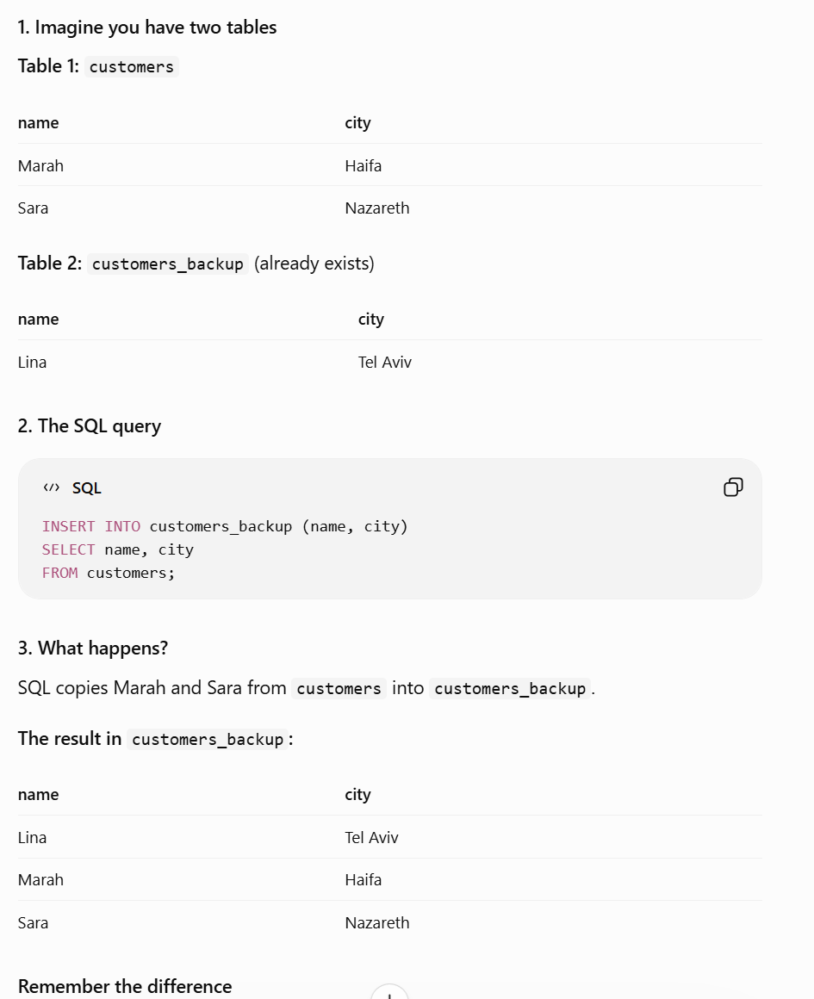
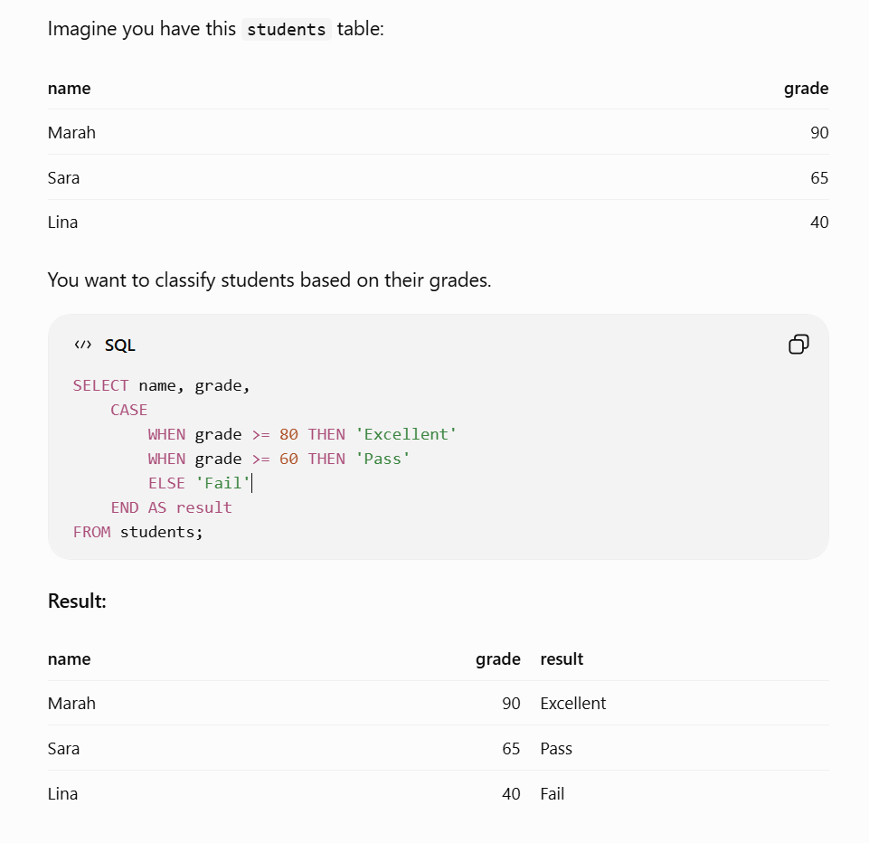

**SQL Cheat Sheet & TutorialA quick reference guide covering essential SQL commands, operators, and data manipulation syntax.**
-----------------------------------------------------------------------

1. Data Retrieval (SELECT)SELECTExtracts data from a database.SQLSELECT column1, column2 FROM table_name;
SELECT DISTINCT Extracts only unique values by eliminating duplicate records.
SELECT DISTINCT column1 
FROM table_name;

2. Filtering Data (WHERE)Filters records to fulfill a specific condition.SQLSELECT * FROM table_name WHERE condition;
Comparison OperatorsThe following operators can be used in the WHERE clause:OperatorDescription=Equal>Greater than<Less than>=Greater than or equal<=Less than or equal<> or !=Not equalBETWEENBetween a certain rangeLIKESearch for a pattern (uses % and _ wildcards)INSpecify multiple possible values for a column3. Logical Operators (AND, OR, NOT)Combine multiple conditions inside a WHERE clause:AND: Displays a record if ALL conditions are TRUE.SQLSELECT * FROM Customers WHERE Country = 'Germany' AND City = 'Berlin';
OR: Displays a record if ANY condition is TRUE.SQLSELECT * FROM Customers WHERE City = 'Berlin' OR City = 'München';
NOT: Returns all records that DO NOT match the specified criteria.SQLSELECT * FROM Customers WHERE NOT Country = 'Germany';
Common NOT Operator CombinationsThe NOT operator can be combined with other operators to exclude data:NOT LIKENOT BETWEENNOT INIS NOT NULLNOT EXISTS4. Sorting Data (ORDER BY)Sorts records in ascending (ASC) by default or descending (DESC) order.SQLSELECT * FROM Products 
ORDER BY UnitPrice DESC;
5. Working with NULL ValuesA NULL value represents unknown, missing, or inapplicable data in a database field.📌 Note: A NULL value is different from zero (0) or an empty string (''). A field with a NULL value is one that has been left blank upon record creation.IS NULL Syntax:SQLSELECT column_names
FROM table_name
WHERE column_name IS NULL;
IS NOT NULL Syntax:SQLSELECT column_names
FROM table_name
WHERE column_name IS NOT NULL;
6. Data Manipulation (DML)INSERT INTO - Used to insert new records into a table.Syntax 1: Specify both column names and values (Recommended)
SQLINSERT INTO table_name (column1, column2, column3, ...)
VALUES (value1, value2, value3, ...);
Syntax 2: Omit column names (When inserting values for ALL columns)The order of the values must match the exact column order in the table.SQLINSERT INTO table_name
VALUES (value1, value2, value3, ...);
UPDATEUsed to update or modify existing records in a table.⚠️ Update Warning! Be careful when updating records. If you omit the WHERE clause, ALL records in the table will be updated!SQLUPDATE table_name
SET column1 = value1, column2 = value2, ...
WHERE condition;
DELETEUsed to delete existing records in a table.Delete specific records:SQLDELETE FROM table_name WHERE condition;
Delete ALL records (Keeps table structure intact):SQLDELETE FROM table_name;
7. DROP TABLECompletely deletes a table and all its data from the database permanently.
SQLDROP TABLE table_name;
8. SELECT TOP -  limit the number of records to return.
9. LIMIT -  Not all database systems support the SELECT TOP clause. MySQL supports the LIMIT clause to select a limited number of records   
```
SELECT column_name(s)
FROM table_name
WHERE condition
LIMIT number;
```
10. SQL Aggregate Functions
- MIN() - returns the smallest value of a column 
MIN() Syntax:
```
SELECT MIN(column_name)
FROM table_name
WHERE condition;
```
- MAX() - returns the largest value of a column
MAX() Syntax:
```
SELECT MAX(column_name)
FROM table_name
WHERE condition;
```
- COUNT() - returns the number of rows in a set
The behavior of COUNT() depends on the argument used within the parentheses:

COUNT(*) - Counts the total number of rows in a table (including NULL values).
COUNT(columnname) - Counts all non-null values in the column.
COUNT(DISTINCT columnname) - Counts only the unique, non-null values in the column.
COUNT() Syntax:
```
SELECT COUNT([DISTINCT] column_name | *)
FROM table_name
WHERE condition;
```
- SUM() - returns the sum of a numerical column
SUM() Syntax
```
SELECT SUM(column_name)
FROM table_name
WHERE condition;
```
- AVG() - returns the average value of a numerical column
AVG() Syntax
```
SELECT AVG(column_name)
FROM table_name
WHERE condition;
```
**Aggregate functions ignore null values (except for COUNT(*)).**

11. LIKE - LIKE operator is used in a WHERE clause to search for a specified pattern within a column's text data.

There are two wildcards often used in conjunction with the LIKE operator:

A percent sign % - represents zero, one, or multiple characters
A underscore sign _ - represents a single character

Syntax
```
SELECT column1, column2, ...
FROM table_name
WHERE columnN LIKE pattern;
```
12. SQL Wildcard Characters - Wildcard characters are used with the LIKE operator. The LIKE operator is used in a WHERE clause to search for a specified pattern in a column.
Wildcard Characters
Symbol	Description
%	Represents zero or more characters
_	Represents a single character
[]	Represents any single character within the brackets *
^	Represents any character not in the brackets *
-	Represents any single character within the specified range *
{}	Represents any escaped character **

* Not supported in PostgreSQL and MySQL databases.

** Supported only in Oracle databases.

13. IN - IN operator is used in the WHERE clause to check if a specified column's value matches any value within a provided list.

Syntax
```
SELECT column_name(s)
FROM table_name
WHERE column_name IN (value1, value2, ...);
```

14. BETWEEN -  The BETWEEN operator is used in the WHERE clause to select values within a specified range.

Syntax
```
SELECT column_name(s)
FROM table_name
WHERE column_name BETWEEN value1 AND value2;
```

15. Aliases - An alias is created with the AS keyword, and is often used to make a column name more readable.

Syntax
Alias for column:
```
SELECT column_name AS alias_name
FROM table_name;
```

Alias for table:
```
SELECT column_name(s)
FROM table_name AS alias_name;
```

16. JOIN  - used to combine rows from two or more tables, based on a related column between them.
Here are the different types of JOINs in SQL:
- (INNER) JOIN: Returns only rows that have matching values in both tables



INNER JOIN Syntax:
```
SELECT column_name(s)
FROM table1
INNER JOIN table2
ON table1.column_name = table2.column_name;
```
JOIN and INNER JOIN will return the same result.
INNER is the default join type for JOIN, so when you write JOIN the parser actually writes INNER JOIN.


- LEFT (OUTER) JOIN: Returns all rows from the left table, and only the matched rows from the right table


LEFT JOIN Syntax:
```
SELECT column_name(s)
FROM table1
LEFT JOIN table2
ON table1.column_name = table2.column_name;
```
- RIGHT (OUTER) JOIN: Returns all rows from the right table, and only the matched rows from the left table



RIGHT JOIN Syntax:
```
SELECT column_name(s)
FROM table1
RIGHT JOIN table2
ON table1.column_name = table2.column_name;
```
- FULL (OUTER) JOIN: Returns all rows when there is a match in either the left or right table



FULL JOIN Syntax:
```
SELECT column_name(s)
FROM table1
FULL JOIN table2
ON table1.column_name = table2.column_name
WHERE condition;
```

17.  Self JOIN - A self join is a regular join, but the table is joined with itself.

Self Join Syntax:
```
SELECT column_name(s)
FROM table1 T1, table1 T2
WHERE condition;
```

**Remember this trick

JOIN: Combine two different tables.

SELF JOIN: Combine a table with itself to compare related rows.

18. UNION - combines the results of two SELECT queries into one list.

UNION Syntax:
```
SELECT column_name(s) FROM table1
UNION
SELECT column_name(s) FROM table2;
```

Imagine you have two tables:

Table 1: Customers from Haifa

name
------
Marah
Sara

Table 2: Customers from Nazareth

name
------
Lina
Ahmad

he SQL query
```
SELECT name
FROM haifa_customers

UNION

SELECT name
FROM nazareth_customers;
```

The result

name
------
Marah
Sara
Lina
Ahmad

**What is the difference between UNION and UNION ALL?
UNION - Removes duplicate rows.
UNION ALL - Keeps duplicates.

The 3 rules of UNION in SQL:

- Same number of columns: Both queries must return the same number of columns.

- Similar data types: The columns must contain compatible types, like text with text or numbers with numbers.

- Same order: The columns must be in the same order in both queries.

Example:
```
SELECT name, age FROM students
UNION
SELECT name, age FROM employees;
```
✅ Both queries return name first and age second, so the requirements are satisfied.

19. GROUP BY - means put rows with the same value together, then calculate something for each group.

Imagine you have this table:

customer     |    country
----------------------------
Marah        |   Israel
Sara         |   Israel
John         |   USA
Lina         |   USA
Ahmad        |   Israel

You want to know how many customers are in each country.
```
SELECT country, COUNT(*)
FROM customers
GROUP BY country;
```
Result:

country | COUNT(*)
Israel  |  3
USA     |  2

Here's what happens:

GROUP BY country → Groups customers by country.

COUNT(*) → Counts the customers in each group.

You can also use other calculations:

SUM() → Adds values.

AVG() → Calculates the average.

MAX() → Finds the highest value.

MIN() → Finds the lowest value.

GROUP BY Syntax:
```
SELECT column1, aggregate_function(column2), column3, ...
FROM table_name
WHERE condition
GROUP BY column1, column3
ORDER BY column_name;
```

The GROUP BY statement is almost always used in conjunction with aggregate functions, like COUNT(), MAX(), MIN(), SUM(), AVG(), to perform calculations on each group.

20. HAVING - is used to filter groups after using GROUP BY.

Remember the difference

- WHERE → Filters individual rows before grouping.

- HAVING → Filters groups after grouping.

HAVING Syntax:
```
SELECT column1, aggregate_function(column2), column3, ...
FROM table_name
WHERE condition
GROUP BY column1, column3
HAVING condition -- The condition on grouped data
ORDER BY column_name;
```

21. EXISTS -   checks whether a query returns at least one row.

- If a matching row exists → EXISTS is TRUE.

- If no matching row exists → EXISTS is FALSE.

The EXISTS operator evaluates to TRUE if the subquery returns at least one row, and FALSE otherwise.

EXISTS Syntax:
```
SELECT column_name(s)
FROM table_name
WHERE EXISTS (subquery);
```

22. ANY-  means compare a value with the values returned by another query. If the comparison is TRUE for at least one value, the condition is TRUE.

ANY Syntax:
```
SELECT column_name(s)
FROM table_name
WHERE column_name operator ANY (subquery);
```

23. ALL - means the condition must be true for every value returned by the query.
Exaple:


ALL Syntax:
```
SELECT column_name(s)
FROM table_name
WHERE column_name operator ALL (subquery);
```

24. SELECT INTO - is used to copy data from an existing table into a new table.

** The SELECT INTO statement is useful for creating backups or for creating a temporary table for analysis.

SELECT INTO Syntax:
Copy entire table into a new table:
```
SELECT * INTO newtable [IN external_db]
FROM sourcetable
WHERE condition;
```

Copy only some columns into a new table:
```
SELECT column1, column2, column3, ...
INTO newtable [IN external_db]
FROM sourcetable
WHERE condition;
```

25. INSERT INTO SELECT -To copy data from one table and insert it into another table.
The INSERT INTO SELECT statement requires that the data types in source and target tables match.

INSERT INTO SELECT Syntax:
Copy all columns from one table to another table:
```
INSERT INTO target_table
SELECT * FROM source_table
WHERE condition;
```

Copy only some columns from one table to another table:
```
INSERT INTO target_table (column1, column2, column3, ...)
SELECT column1, column2, column3, ...
FROM source_table
WHERE condition;
``

Example:


26. CASE - The SQL CASE expression works like IF / ELSE in programming.
It checks a condition and returns a result depending on whether the condition is true.

CASE Syntax:
```
CASE
  WHEN condition1 THEN result1
  WHEN condition2 THEN result2
  WHEN conditionN THEN resultN
  ELSE default_result
END;
```

Example:

4
--------------------------------------------------------------------------

A Stored Procedure in SQL is a saved group of SQL statements that you can run whenever you need them.

Think of it like a recipe: you write the instructions once, save them, and reuse them later.

Example

Imagine you often want to see all customers from Israel.

You can save this query as a stored procedure:
```
CREATE PROCEDURE GetCustomers
AS
BEGIN
    SELECT *
    FROM customers
    WHERE country = 'Israel';
END;
```
Now you can run it whenever you want:
```
EXEC GetCustomers;
```
Instead of writing the whole query every time, you just call the procedure!

Remember:

- CREATE PROCEDURE → Creates and saves the procedure.

- SELECT → Defines what data to retrieve.

- EXEC → Runs the saved procedure in SQL Server.